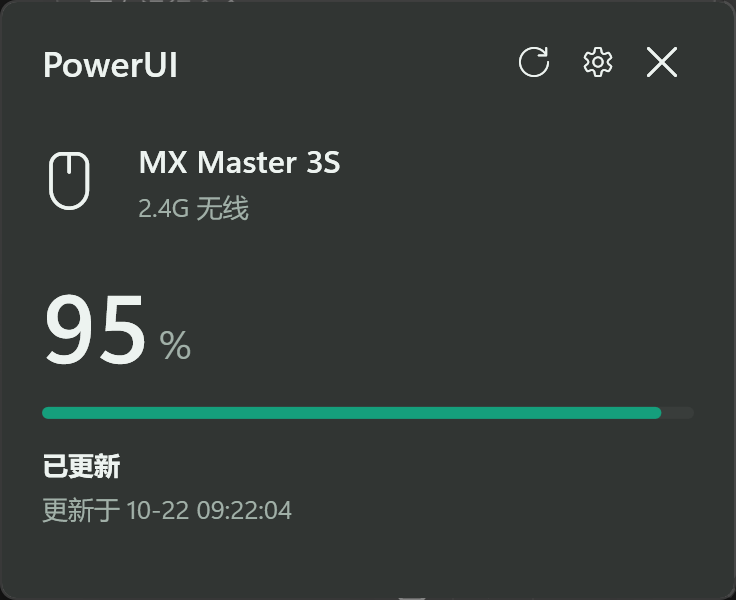
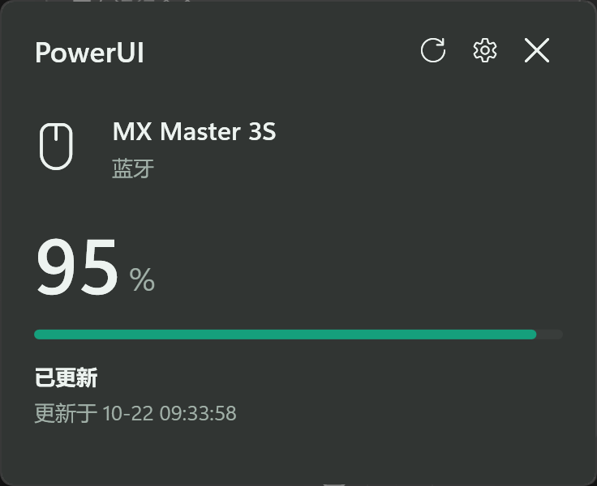

# PowerUI


Windows 11 无线鼠标与键盘电量托盘工具。支持双设备独立监控、环状电量托盘图标和磨砂玻璃弹出面板，不需要厂商控制中心常驻。

[下载便携版](https://github.com/realshiyu/powerui/releases) · [兼容设备](#兼容设备) · [构建](#从源码构建) · [报告问题](https://github.com/realshiyu/powerui/issues)


图标样式示例，圆环不代表实时电量。

## 开发说明

本应用由 ChatGPT / Codex 全程编写与实现，作者负责需求、设计决策和实机验收。

## 实测截图

2026-10-22，MX Master 3S 在本机通过 Logi Bolt 和蓝牙分别读取到 `95%`，均为未充电状态。以下为应用面板的真实截图，电量仅代表截图时的读数。

| Logi Bolt 连接 | 蓝牙连接 |
| --- | --- |
|  |  |

Bolt 截图取自首次适配验证，连接标签为当时版本的“2.4G 无线”；当前版本显示“Logi Bolt · 2.4G 无线”。

## 功能

VGN S99 键盘监控及双设备托盘为当前源码新增功能，发布包支持范围请以对应版本的发行说明为准。

- 托盘外圈按比例显示电量，中心区分鼠标和键盘，随任务栏深浅主题切换白色或深色图形。电量 >40% 为绿色、21%-40% 为黄色、≤20% 为红色；未取得新读数时显示灰色虚线环。悬停或打开面板查看精确百分比和充电状态。环颜色与可配置的提醒阈值独立。
- Windows 11 Acrylic 面板，跟随系统深浅色，提供不透明回退。
- 鼠标与键盘可在各自面板的设置中独立选择电量查询间隔：1分钟、5分钟、10分钟或半小时，默认1分钟，自动保存。启动时立即查询，手动刷新不受间隔限制。雷柏被动接收电量报告，罗技 Bolt / 蓝牙使用只读 HID++ 查询，VGN S99 使用只读电量查询；各自单次读取预算 5 秒，互不阻塞。
- 托盘设置可选“分别显示”“仅鼠标”“仅键盘”。单图标模式仍在后台监控两类设备，右键菜单可查看另一类设备。鼠标与键盘各自保存提醒阈值和提醒状态。耳机、音响图形已预备，但尚未接入设备读取。
- 读数有效期为查询间隔加1分钟，且至少5分钟；过期后显示 `--`，详情保留上次读数及时间。
- 默认电量不高于 20% 时提醒一次；新读数高于 25% 后才允许下一轮提醒，重启不会重复提醒。
- 可调整提醒阈值（5%–90%）、关闭提醒，可选开机启动且默认关闭。
- 单个 EXE 免安装运行，无第三方运行库、不安装服务、不要求管理员权限。

## 兼容设备

**目前不是通用的 2.4G 外设电量工具。** 不同品牌、型号与固件可能使用不同协议。

| 设备 | 接口 VID:PID | 状态 |
| --- | --- | --- |
| 雷柏 VT3S MAX | `24AE:1421` | 已实机读取真实电量 |
| 雷柏 VT3 MAX | `24AE:1417` | 已实现协议匹配，未实机验证 |
| 罗技 MX Master 3S（Logi Bolt） | `046D:C548` | 已实机读取真实电量 |
| 罗技 MX Master 3S（蓝牙） | `046D:B034` | 已实机读取真实电量 |
| VGN S99（2.4G） | `320F:5088` | 已实机读取真实电量；不承诺同 VID/PID 的其他型号 |

可同时监控一只支持的鼠标与一把 VGN S99 键盘。鼠标仍仅处理单个匹配接口，蓝牙与接收器同时匹配或多个鼠标接口时拒绝自动选择；多个 S99 接收器同样拒绝自动选择，不影响另一类设备监控。Bolt 动态发现配对槽位，蓝牙直接访问设备；均动态查询型号及电量功能，仅展示 MX Master 3S。S99 严格匹配产品名、VID/PID、厂商集合与报告格式，不支持其蓝牙或有线模式。未覆盖的设备不会使用猜测命令尝试读取。

2026-10-23，本机应用同时读取到 S99 `54%` 和 MX Master 3S `95%`，并验证了 60 秒自动刷新及三种托盘模式的重启恢复。已通过应用自身截图检查 200% 缩放下的深浅色设置面板；设置控件的实际点击切换尚未完成自动化验证。

雷柏的纯充电状态报告不当作新的百分比，避免错误显示为 `0%`；罗技独立校验百分比和充电状态字段。S99 的百分比已实测，充电标记解释仅有协议源码依据。低电量通知实际送达、真实充电/睡眠/拔插转换、开机登录启动和多显示器仍待更多实机验证。

## 使用

1. 从 [Releases](https://github.com/realshiyu/powerui/releases) 下载 `PowerUI.exe`（或下载 ZIP 后解压），放到当前用户可写目录。
2. 启动 `PowerUI.exe`，左键托盘图标打开面板，右键菜单或设置中退出。
3. 初次启动若 Windows 将图标放在托盘折叠区，可将其拖到任务栏通知区域。
4. 在任一设备面板的设置中选择“托盘显示”：分别显示两个图标，或只显示鼠标/键盘。单图标模式下，可从右键菜单“查看鼠标”“查看键盘”打开另一类设备面板；两类设备始终独立刷新。

要求 Windows 11 x64 和系统自带的 .NET Framework 4.8 或更新版本。Windows 11 22H2 / build 22621 起支持本项目使用的 DWM Acrylic 属性；旧版本回退为不透明背景。开发版暂未签名，仅运行自己构建或可信来源的文件，不要关闭系统安全保护。

鼠标设置和上次电量保存在程序旁的 `PowerUI.state.xml`，全局托盘显示模式也保存在此文件；键盘使用独立的 `PowerUI.keyboard.state.xml`，两者上一份状态均保存在各自 `.bak`。移动便携文件夹时保留它们；启用过开机启动的，移动程序后需重新开启。首次保存失败时请换用可写目录，而不是提权运行。

分发时只需一个 `PowerUI.exe`，无需旁置 `.config`、DLL 或诊断工具；运行后生成的状态文件不是启动依赖。使用说明、MIT 许可和第三方声明已内嵌，可从托盘右键菜单的“关于 PowerUI”或 `PowerUI.exe --about` 查看。

## 隐私与设备安全

应用运行时不联网、无遥测、不采集键盘按键或鼠标位移、不上传设备数据。不修改 DPI、按键、灯效或固件。雷柏常规刷新仅被动读取电量报告；罗技 Bolt / 蓝牙发送只读型号、功能发现、电量能力及状态查询；S99 仅访问厂商定义接口发送只读电量查询，不打开按键输入集合，不发送配置命令。

开机启动仅在用户主动打开选项时写入当前用户的注册表 Run 项。运行状态、原始诊断记录及日志不纳入源码或发布包；README 中仅保留人工确认的应用面板截图，不包含设备路径或序列号。

## 从源码构建

在 Windows x64 的 PowerShell 中执行：

```powershell
git clone https://github.com/realshiyu/powerui.git
Set-Location powerui
.\build.ps1
.\package.ps1
```

脚本使用系统 .NET Framework C# 编译器，不需要 .NET SDK、NuGet 或 npm。若当前 PowerShell 策略不允许运行脚本，请遵循所在组织的脚本执行规则，不要修改整机安全策略。

单文件产物为 `artifacts/portable/PowerUI.exe`，ZIP 位于 `artifacts/`，其中仅包含这个 EXE，不包含开发机的设置或读数。程序依然使用 Windows 自带的 .NET Framework，不捆绑额外运行时。CI 只验证构建与打包，不代表真实设备兼容性验证。

## 电量诊断

```powershell
.\build.ps1 -IncludeProbe
.\artifacts\portable\PowerUI.Probe.exe
.\artifacts\portable\PowerUI.Probe.exe --listen
.\artifacts\portable\PowerUI.Probe.exe --logitech
.\artifacts\portable\PowerUI.Probe.exe --vgn-battery
```

诊断工具仅按需构建，不随单文件便携包分发。

无参数只读枚举雷柏、罗技和 VGN HID 描述符；`--listen` 最多等待 8 秒，只解析雷柏电量报告。`--logitech` 对单个严格匹配的 Bolt 或 MX Master 3S 蓝牙接口进行只读 HID++ 查询，最多使用 8 秒预算。`--vgn` 仅枚举，`--vgn-battery` 只读查询严格匹配的 S99 2.4G 接收器电量。诊断不输出设备路径或序列号。

`--query` 是实验性诊断选项，会向严格匹配的鼠标接收器发送固件/电量只读请求。其 ACK 行为尚未验证通过，常规托盘应用不使用该路径，不推荐普通用户排障时运行。

排障先确认型号、连接方式、接收器是否可见，以及是否有有效电量报告。一次读取超时不能证明鼠标离线或不兼容。隔离/沙箱环境的设备访问拒绝也不意味着日常使用必须提权。

## 开发与贡献

项目采用 C# / WPF、NotifyIcon、Windows SetupAPI/HID 和 DWM。源文件在 `src/`，构建入口为 `build.ps1`，发布入口为 `package.ps1`。

新增设备前请阅读 [协议说明](docs/protocol.md)、[S99 协议及实机记录](docs/s99-protocol-research.md) 和 [贡献指南](CONTRIBUTING.md)。安全问题见 [SECURITY.md](SECURITY.md)，版本变更见 [CHANGELOG.md](CHANGELOG.md)。

## 许可与声明

[MIT License](LICENSE)，Copyright (c) 2026 realshiyu。第三方资料与商标说明见 [THIRD_PARTY_NOTICES.md](THIRD_PARTY_NOTICES.md)。

这是独立社区项目，与雷柏 / RAPOO、罗技 / Logitech、VGN 无隶属、授权或背书关系；不包含厂商驱动、固件或官方网页驱动源码。
